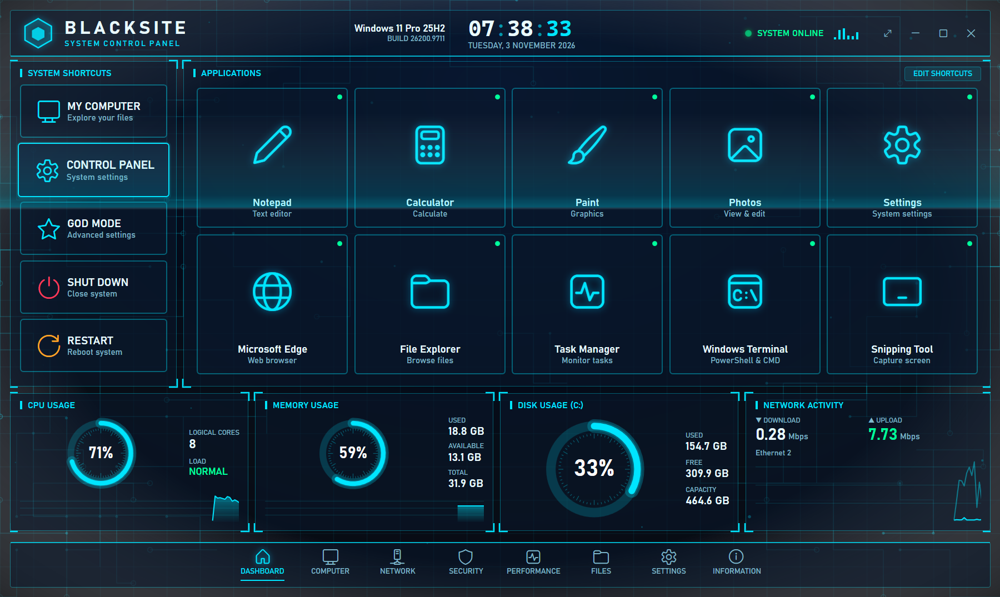
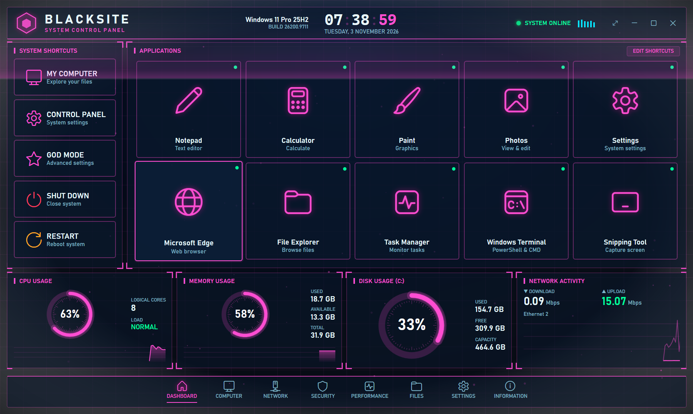
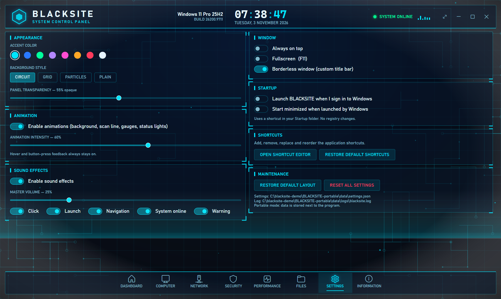
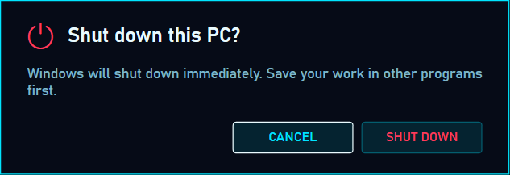

# BLACKSITE — System Control Panel

A futuristic, hacker-style command dashboard for Windows 11. It is a **real** desktop app (C# / .NET 8 / WPF):
one-click shortcuts to system tools and your favourite programs, plus live CPU, memory, disk and network
monitoring read straight from Windows. Nothing on screen is simulated.



<p align="center">
  
  
</p>
<p align="center">
  
</p>

**Download:** grab the installer or the portable zip from the [latest release](https://github.com/unupunct/Blacksite-Win11-Dashboard/releases/latest).

| Area | What you get |
|---|---|
| **System shortcuts** | My Computer, Control Panel, God Mode, **Shut Down** and **Restart** (both always ask for confirmation) |
| **Applications** | 10 launchable cards (Notepad, Calculator, Paint, Photos, Settings, Edge, File Explorer, Task Manager, Windows Terminal, Snipping Tool). Missing apps are flagged *UNAVAILABLE* and can be pointed at a program manually |
| **Live monitoring** | CPU, memory, disk (C:) and network (Mbps) gauges and scrolling graphs, refreshed every second |
| **Pages** | Dashboard, Performance, Settings, Information. Computer / Network / Security / Files are clearly marked *future modules* |
| **Customisation** | Accent colour, background style, panel transparency, animation on/off + intensity, sound effects with per-sound switches and volume, always-on-top, fullscreen, borderless window, launch at sign-in |
| **Shortcut editor** | Add, edit/replace, remove, drag-and-drop reorder, custom icons, restore defaults; targets validated before saving |

## Quick start

* **Installer:** run `BlackSite-<version>-Setup-win-x64.exe` (per-user, no administrator rights). See [docs/INSTALL.md](docs/INSTALL.md).
* **Portable:** unzip `BlackSite-<version>-portable-win-x64.zip` anywhere and run `BlackSite.exe`. Settings stay in the `data` folder beside it.

No .NET installation is required — the runtime is bundled.

## Documentation

* [Installation](docs/INSTALL.md)
* [User manual](docs/USER-MANUAL.md)
* [Build instructions](docs/BUILD.md)
* [Troubleshooting](docs/TROUBLESHOOTING.md)

## Safety design

* Runs as a normal user and never asks for administrator rights.
* Shut Down / Restart execute only after the user presses **Confirm** in a dialog whose default button is **Cancel**. The power code itself refuses to run without that confirmation (unit-tested).
* Custom shortcuts may point only at `.exe`, `.lnk`, `.msc`, `.cpl` files or at `ms-*:`, `http(s):` and `shell:AppsFolder\…` links. They can **never** carry command-line arguments, so edited settings files cannot be used to run arbitrary commands. Invalid entries in `settings.json` are dropped on load.
* No registry changes by the app. (The installer registers a normal *Installed apps* entry; "launch at sign-in" uses a shortcut in your Startup folder.)
* Never touches Windows Defender, the firewall or UAC.

## Project layout

```
src/BlackSite.Core   logic with no UI: settings, logging, launcher, validator, power, monitoring
src/BlackSite.App    WPF UI: window, dashboard/performance/settings/info pages, dialogs, theme, audio
tests/BlackSite.Tests  unit tests (xUnit)
tools/               UI automation tests, screenshot and icon scripts
installer/ scripts/  Inno Setup script and the release build
```

## Verification status

* 29 unit tests (launching, validation, persistence, power confirmation, monitoring maths).
* UI automation (`tools/ui-test.ps1`, `tools/ui-test2.ps1`) on Windows 11 Pro 25H2: every shortcut launched a real window; both power dialogs appear with Cancel/Confirm and were cancelled; fullscreen, resize, always-on-top and settings persistence across a restart pass.
* **Not exercised:** an actual shut down / restart (deliberately), and behaviour after a Windows reboot or sign-in with "launch at sign-in" enabled.

## Licence

Personal project. No licence has been chosen yet.
